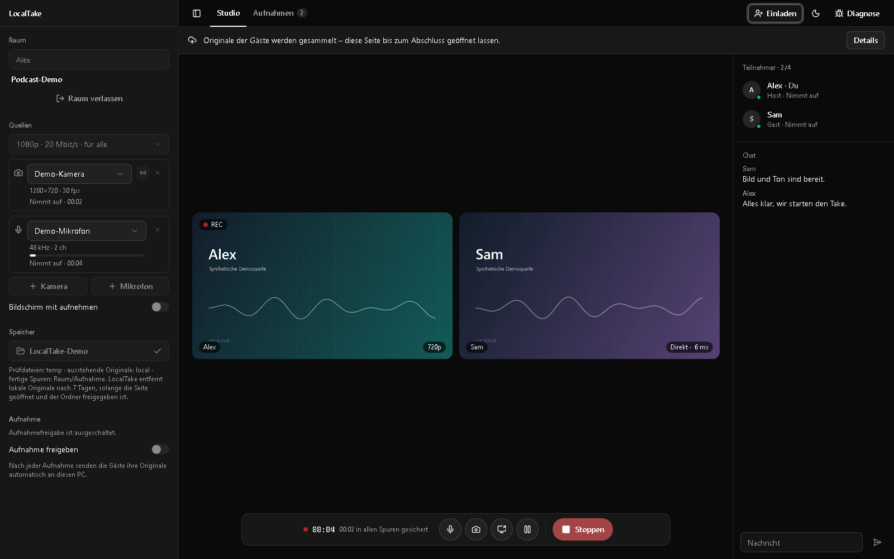
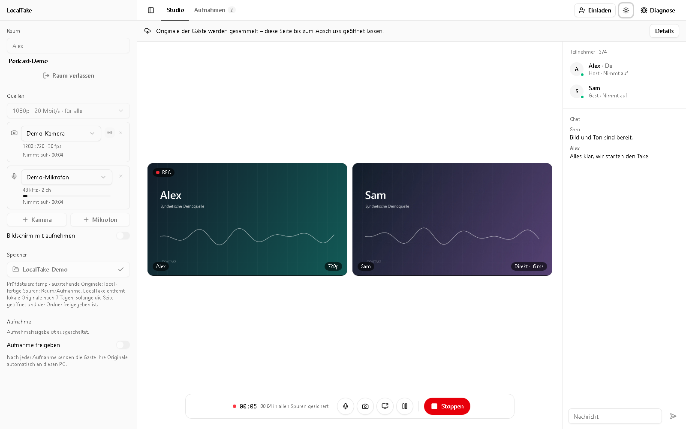
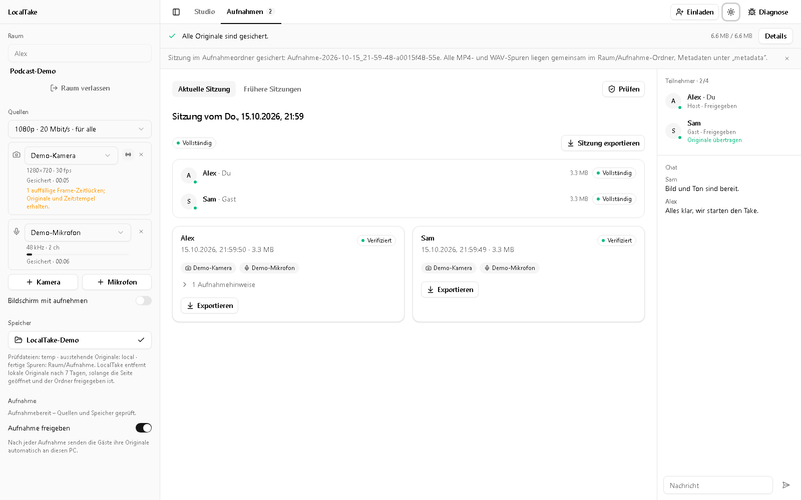

# LocalTake [](https://github.com/openai/codex)

Ein selbst gehostetes Aufnahmestudio für Gespräche mit **2–4 Teilnehmern**. Alle sehen und hören sich im Browser, während jede Kamera und jedes Mikrofon auf dem jeweiligen Rechner separat aufgezeichnet wird. Nach dem Stopp sammelt der Host die Originalspuren automatisch für den Schnitt.

Die lokale Aufnahmequalität bleibt unabhängig von der Qualität der Liveverbindung. Der Server koordiniert das Studio und speichert keine Audio- oder Videoaufnahmen.



## Funktionen

- **Getrennte Originalspuren:** mehrere Kameras und Mikrofone pro Rechner, H.264-Video als MP4 und PCM-Audio als WAV.
- **Gemeinsames Studio:** Einladung per Link, Livevideo und Audio über WebRTC, Chat und Bildschirmfreigabe.
- **Aufnahme durch den Host:** gemeinsame Qualitätswahl, Start und Stopp; jeder Teilnehmer kann seine eigene Aufnahme stoppen.
- **Automatische Vorprüfung:** Quellen und Schreibzugriff werden vor der Aufnahme und nach Änderungen geprüft. Fehlende Freigaben und Gerätefehler bleiben sichtbar.
- **Wiederaufnehmbare Übertragung:** Gäste senden ihre Originale nach dem Take direkt an den Host. Prüfsummen und gespeicherte Empfangsbestätigungen sichern die Übernahme ab.
- **Ausgabe für den Schnitt:** ein Ordner je Take mit den MP4-/WAV-Spuren aller Teilnehmer und separaten Metadaten. Video wird ohne erneutes Kodieren zusammengeführt.
- **Wiederöffnen und Diagnose:** gespeicherte Raumidentität, fortsetzbare Übertragung, lokale Diagnoseberichte sowie Hell-, Dunkel- und Systemdarstellung.

## Screenshots

Studio mit Einrichtung, Teilnehmern und Chat:



Abgeschlossener Take mit dem Übertragungsstatus aller Teilnehmer:



Die Screenshots zeigen die tatsächliche Oberfläche mit synthetischen Kamera- und Tonquellen und fiktiven Teilnehmern.

## Voraussetzungen

- **Desktop-Chrome oder Microsoft Edge** mit WebCodecs und File System Access API.
- **HTTPS oder localhost**, damit Kamera, Mikrofon und Aufnahmeordner verfügbar sind.
- **Kopfhörer** und ein lokaler Aufnahmeordner mit ausreichend freiem Platz.
- Für die Entwicklung: **Node.js ab 22.19 und npm**. Das Docker-Image verwendet Node.js 24.

Unter Windows einen kurzen Basispfad wie `C:\LocalTake` wählen: Browser und temporäre Schreibdateien können an der Windows-Pfadgrenze scheitern. Ordner mit aktiver Cloud-Synchronisierung möglichst vermeiden. Browser ohne native Ordnerfreigabe sind derzeit kein unterstützter Aufnahmeweg; die alternative Browserablage ist deaktiviert.

## Lokal starten

```sh
git clone https://github.com/PaulFreund/LocalTake.git
cd LocalTake
npm ci
cp .env.example .env
node -e "console.log(require('node:crypto').randomBytes(32).toString('hex'))"
```

Unter PowerShell entspricht `Copy-Item .env.example .env` dem Kopieren. Eine bereits vorhandene `.env` behalten. Den erzeugten Zufallswert in `.env` als `ROOM_SIGNING_SECRET` eintragen und anschließend starten:

```sh
npm run dev
```

Das Studio ist unter **http://localhost:43171** erreichbar. Der Koordinator lauscht lokal auf Port `43170`; Vite leitet API und WebSocket dorthin weiter. Bei anderen Ports auch `PUBLIC_ORIGIN` passend setzen. Kein `NODE_ENV=development` in die `.env` schreiben, da dies den Produktionsbuild beeinflusst.

## Einen Take aufnehmen

1. Aufnahmeordner freigeben, Namen eingeben und einen Raum mit eigenem Raumnamen erstellen.
2. Über **Einladen** den Raumlink teilen. Gäste öffnen ihn, wählen ihren Namen und geben ihren eigenen Aufnahmeordner frei.
3. Kameras und Mikrofone in der Einrichtung auswählen. Weitere Quellen lassen sich über **+ Kamera** und **+ Mikrofon** hinzufügen. Die automatische Vorprüfung abwarten und die Aufnahmefreigabe kontrollieren.
4. Der Host wählt die Qualität und startet die gemeinsame Aufnahme. Mikrofon stumm und Kamera aus wirken auch auf die Originalspuren.
5. Nach dem Stopp die Browser geöffnet lassen, bis die Übertragung beim Host vollständig ist. Nach Unterbrechungen denselben Raum erneut öffnen und den Ordner freigeben.
6. Unter **Aufnahmen** den Take prüfen und bei Bedarf erneut exportieren. Die Dateien liegen unter `<Raumname>/Aufnahme-<Datum_Uhrzeit>-<ID>/`; Datum und Uhrzeit im Ordnernamen verwenden Europe/Berlin.

**Aufbewahrung:** Fertige Aufnahmeordner bleiben erhalten. Temporäre Prüfdateien werden sofort entfernt. Lokale Originalsegmente werden nach bestätigter Übertragung beziehungsweise verifiziertem Export bereinigt; auch unvollständige lokale Teilbestände werden nach sieben Tagen entfernt, sobald die Anwendung mit freigegebenem Ordner läuft. Wichtige Aufnahmen und Teilbestände rechtzeitig sichern.

## Selbst hosten

Die mitgelieferte Compose-Konfiguration startet die Anwendung hinter Caddy mit HTTPS. Ein optionaler, authentifizierter TURN-Dienst hilft bei Verbindungen zwischen restriktiven Netzen.

Die vollständige Einrichtung mit Domain, unabhängigen Zufallsschlüsseln, Ports und Diagnoseoptionen steht in **[deploy/README.md](deploy/README.md)**. Alle Domains und Adressen in den Beispielen sind Platzhalter oder lokale Testadressen. Eigene Zugangsdaten und Instanzkonfiguration gehören außerhalb des Repositorys.

## Entwicklung

```sh
npm test
npm run typecheck
npm run build
npm run format:check
npm audit
```

`npm start` startet den gebauten Dienst. Für einen lokalen Test des Builds `PUBLIC_ORIGIN=http://localhost:43170` setzen; Produktion erfordert `NODE_ENV=production`, HTTPS und einen dauerhaft gespeicherten zufälligen Signaturschlüssel.

| Bereich              | Technik                                                            |
| -------------------- | ------------------------------------------------------------------ |
| Oberfläche           | Vue, TypeScript, Tailwind CSS, shadcn-vue / reka-ui                |
| Aufnahme             | WebCodecs, AudioWorklet, Mediabunny, File System Access API        |
| Live und Übertragung | WebRTC-Mesh und DataChannels mit STUN/TURN                         |
| Koordinator          | Node.js, Fastify, WebSocket; flüchtiger Raumzustand ohne Datenbank |
| Betrieb              | Docker, Caddy, optional coturn                                     |

## Stand und Grenzen

LocalTake ist ein experimentelles Aufnahmestudio. Automatisierte Tests und synthetische Browserprüfungen decken Aufnahme, Export, Wiederverbindung und Übertragung ab. Sie ersetzen keine Abnahme der eigenen Geräte, Netze und Aufnahmedauer. Vier reale Rechner, lange Mehrkameraaufnahmen, Mehr-Gigabyte-Exporte und physische Latenzmessungen bleiben eigene Systemtests. Netzwerk- oder Browserausfälle können ungesicherte Aufnahmeenden verlieren; bestätigte Segmente werden getrennt gespeichert.

Raumlinks sind Zugangsberechtigungen und sollten vertraulich geteilt werden. Es gibt keine Benutzerkonten oder vorgeschaltete Administratoranmeldung: Jeder mit Zugriff auf die Instanz kann einen Raum erstellen. Optionale Serverdiagnosen können IP-Adressen und Browserinformationen enthalten. Details stehen in der [Architektur](docs/architecture.md) und der [Telemetriedokumentation](docs/telemetry.md).

## Weitere Dokumentation

- [Prüfstand und reproduzierbare Prüfungen](docs/verification.md)
- [Anforderungen und offene Abnahme](docs/acceptance.md)
- [Architektur](docs/architecture.md)
- [Aufnahmeformat, Wiederherstellung und Export](docs/recording-format.md)
- [Implementierungsplan und Systemtests](docs/implementation-plan.md)
- [Herkunft und Lizenzen der UI-Komponenten](apps/client/src/ui/NOTICE.md)
